# 🔧 Servis Defteri

**Küçük oto servisler için tek ekranlı iş emri ve servis geçmişi uygulaması.**
Telefondan kullanılır, dükkandaki bir Windows bilgisayarda ya da Linux/Raspberry Pi'de çalışır, bulut aboneliği gerektirmez.

[English summary below](#english-summary)

> ⚠️ **Lisans: yalnızca inceleme.** Bu depodaki kodu okuyabilirsin; çalıştırmak, kullanmak, kopyalamak veya dağıtmak için izin yoktur. Ayrıntı: [LICENSE](LICENSE).

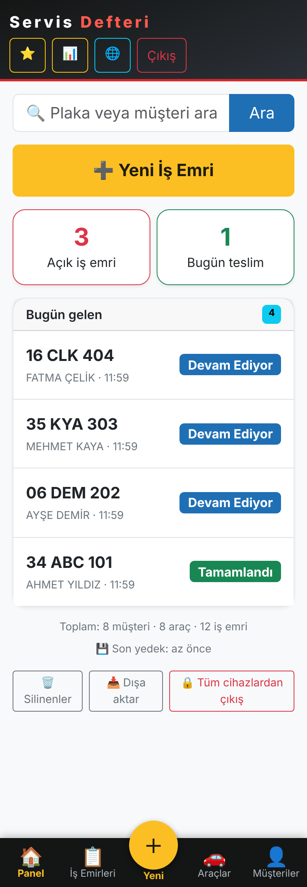

---

## Ne işe yarar?

Küçük bir servisin en büyük derdi **kayıt tutmak**: "Bu araç en son ne zaman geldi, ne yapıldı?" Servis Defteri bunu
**araç geldiği anda 10 saniyede** kayda alır ve müşteriye **kendi aracının servis geçmişini gösteren bir QR kartı** verir.

Tasarım ilkesi: **usta elleri yağlıyken telefonla kullanabilmeli.** Az alan, büyük düğme, ezber gerektirmeyen akış.
Yeni iş emri için **yalnızca plaka ve giriş km** zorunludur; müşteri adı, telefon, marka ve model isteğe bağlıdır.

## Depo yapısı: Windows, Linux ve çok dükkânlı (bulut) ayrı klasörler

| Klasör | Ne için | Kurulum |
|---|---|---|
| [`windows/`](windows) | Dükkandaki Windows 10/11 bilgisayar | [`WINDOWS-KURULUM.txt`](windows/WINDOWS-KURULUM.txt) — `SERVIS-DEFTERI-KUR.bat` ile tek tıkla |
| [`linux/`](linux) | Raspberry Pi / Debian / Ubuntu | [`LINUX-KURULUM.md`](linux/LINUX-KURULUM.md) — `bash scripts/kurulum.sh` |
| [`bulut/`](bulut) | **Çok dükkânlı**: internete açık tek Linux sunucu, her dükkân kendi kullanıcı adı + şifresiyle | [`BULUT-KURULUM.md`](bulut/BULUT-KURULUM.md) — `bash scripts/kurulum.sh` |

İki klasörde uygulama (`app.py`, `templates/`, `static/`) aynıdır; yalnızca kurulum, çalıştırma ve yedek betikleri
platforma göre farklıdır. Her klasör kendi başına bir pakettir. `bulut/` ise aynı uygulamanın **çok dükkânlı** halidir (aşağıda). Ayırt etmek için renk paketleri farklıdır: **Windows mavi**, **Linux yeşil**. Alan adı bağlama (Cloudflare Tunnel) için her klasörde `DOMAIN-BAGLAMA.txt` vardır.

### Çok dükkânlı sürüm (`bulut/`)

Tek sunucuda birden fazla dükkân: her dükkân **kendi kullanıcı adı ve şifresiyle** girer, verisi **tamamen ayrı** bir veritabanı dosyasındadır (başkası göremez). Hesapları yalnızca yönetici açar (`/yonetici`): geçici şifre üretilir, dükkân ilk girişte kendi şifresini seçer; unutulursa yönetici sıfırlar. Sunucu yazıcıya bağlanmaz: etiket, dükkândaki **Bluetooth (BLE) yazıcıya telefondan** basılır. Sunucuda dükkân başına otomatik yedek (`scripts/backup.py`), dükkân kendi yedeğini panelden indirebilir, geri yükleme yöneticidedir (`scripts/geri_yukle.py`). İsteğe bağlı **entegrasyon API'si** dükkân başınadır: anahtarı yalnızca yönetici üretir, anahtar hangi dükkânın verisine yazılacağını belirler. Vitrin sayfası, USB yazıcı ve Windows kurulumu bu sürümde yoktur.

| Yönetici: dükkân aç | Dükkân girişi | İlk giriş: şifre seç | Etiket (Bluetooth) |
|---|---|---|---|
| 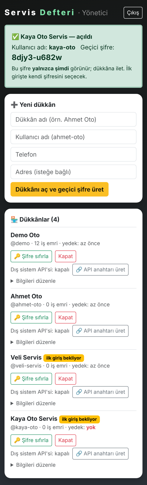 | 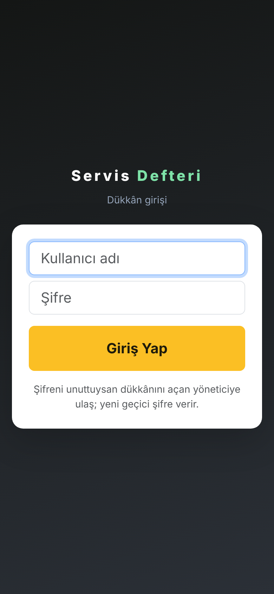 | 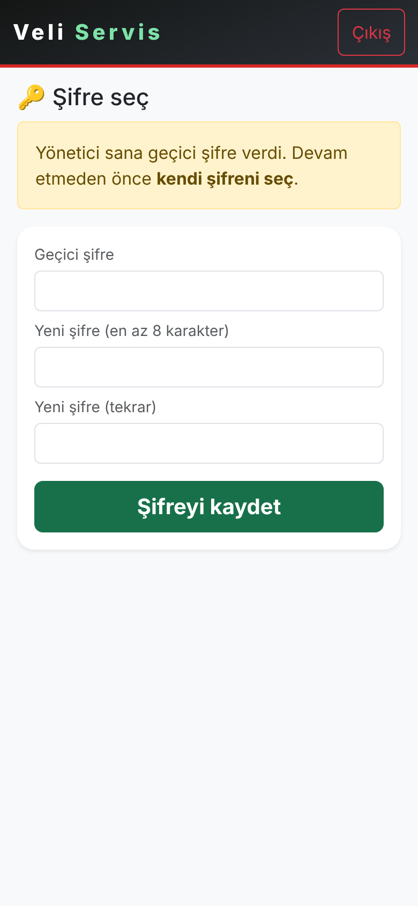 | 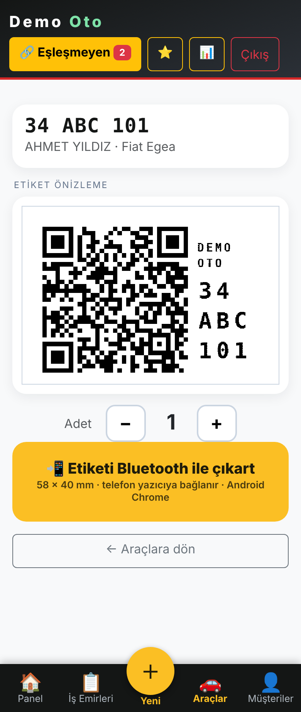 |

| Yönetici: dükkâna API anahtarı | Dış sistemden gelen: eşleşmeyen kayıtlar |
|---|---|
| 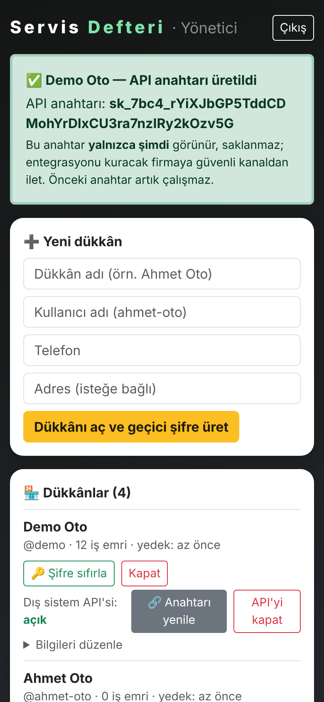 | 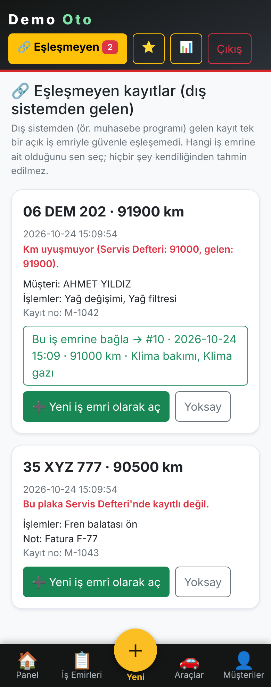 |

## Genel işleyiş

```
Araç gelir ──► Plaka + giriş km ──► Araç/müşteri otomatik bulunur (yoksa açılır)
      │
      ▼
  İşlemler seçilir (sık yapılanlar tek dokunuş) ──► İş emri açılır
      │
      ▼
  Devam Ediyor ──► "Araç hazır" WhatsApp mesajı ──► Teslim Et (= Tamamlandı)
      │
      ▼
  Araç etiketi (QR) yazdırılır ──► sonraki gelişte QR okutulur, geçmiş görünür
```

1. **Vitrin sayfası (`/`)** – Herkese açık tanıtım: açık/kapalı rozeti, ara / WhatsApp / yol tarifi. `.env` ile ayarlanır.
2. **Usta paneli** – Şifre korumalı: açık işler, müşteriler, araçlar, istatistik.
3. **QR servis kartı (`/arac/<token>`)** – Araca özel, tahmin edilemez adres. Müşteri geçmişi görür (kişisel bilgiler maskeli); usta girişliyse Ara / Haber Et / Yeni İş Emri çubuğu çıkar.
4. **Etiket yazdırma** – 58×40 mm yatay QR etiketi, USB TSPL termal yazıcıya tek dokunuşla (Xprinter XP-470B). Sunucu evde, yazıcı dükkânda ise telefondan Bluetooth (BLE) ile de basılabilir (Android Chrome + HTTPS, bkz. `docs/YAZICI.md`).

## Özellikler

- Tek ekranda **hızlı iş emri** (plaka biçimi doğrulama, araç/müşteri otomatik bulma)
- **İşlem seçici**: sık yapılanlar öğrenilir, kategoriler, kendi işlemini ekleme ("Eklediklerim")
- Durum akışı: Beklemede → Devam Ediyor → Tamamlandı (araç teslim edilince)
- Para takibi bilinçli olarak yoktur; yalnızca servis kaydı tutulur
- İsteğe bağlı **entegrasyon API'si** (varsayılan kapalı, yalnızca HTTPS + API anahtarı): muhasebe programı plakadaki tek açık iş emrine işlem, durum ve not ekler; yeni iş emri açmaz, emin olunamayanlar "Eşleşmeyen" listesinde onay bekler. Windows ve Linux'ta; API belgesi (PDF), OpenAPI, 5 dilde örnek kod ve dışarıdan deneme aracı `docs/` ile `DISARIDAN-GONDER` klasöründedir
- **WhatsApp şablonları**, arama, istatistik, **Excel/CSV dışa aktarma**, **Silinenler** (30 gün geri alınabilir), **Hareketler** (hangi cihaz ne yaptı; İstatistik sayfasında, 180 gün)
- **Yedek**: gece otomatik yedek; Windows'ta USB bellek ve Google Drive, Linux'ta USB ve rclone seçenekleri
- **Çevrimdışı çalışır** (Bootstrap yerel dosyadır), telefonda öncelikli arayüz, Türkçe

## Ekran görüntüleri (Windows, mavi tema)

| | | |
|---|---|---|
| 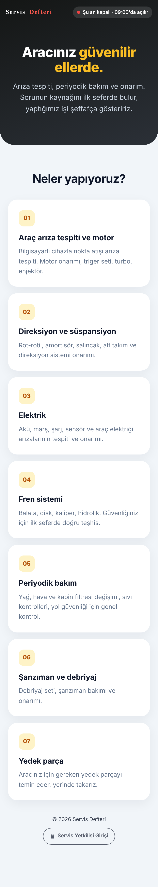 <br> Vitrin | 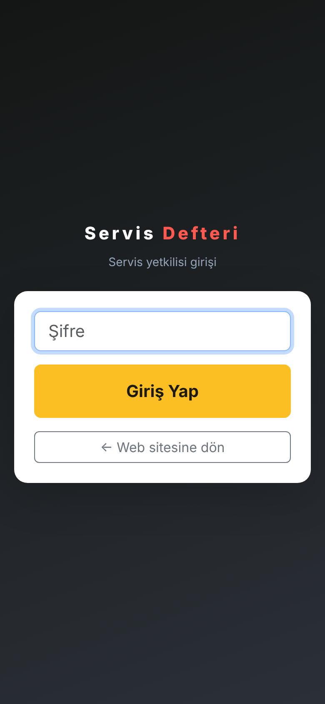 <br> Giriş |  <br> Panel |
| 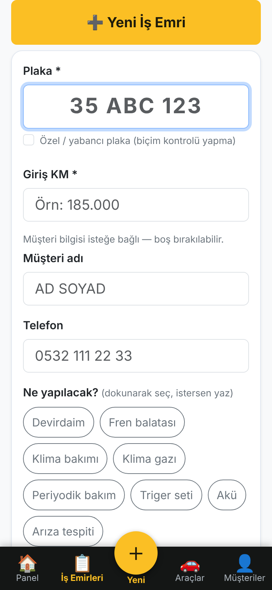 <br> Hızlı iş emri | 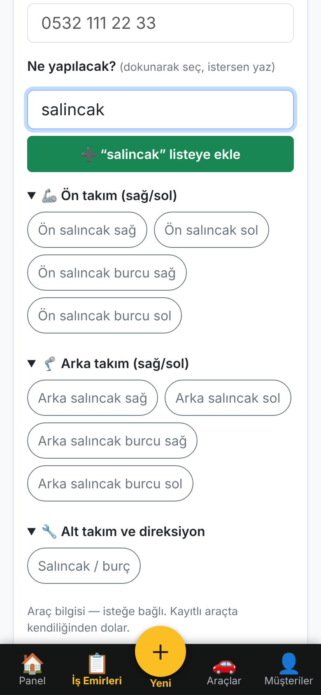 <br> İşlem seçici | 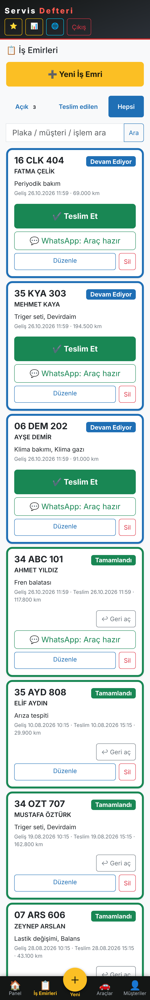 <br> İş emirleri |
| 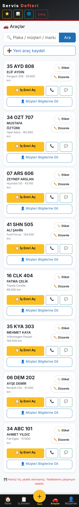 <br> Araçlar | 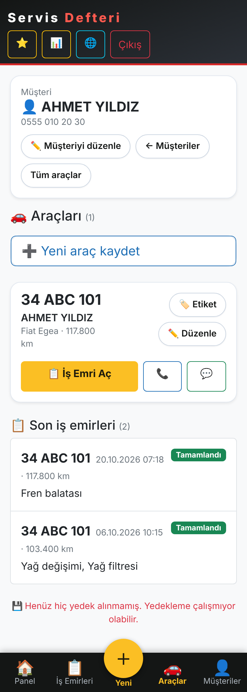 <br> Müşterinin araçları | 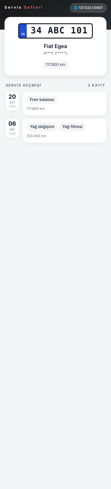 <br> QR kartı (müşteri) |
| 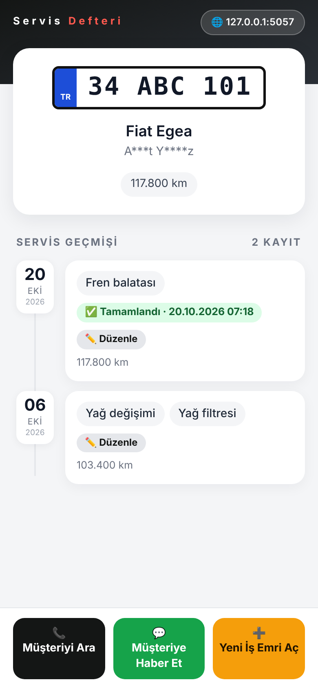 <br> QR kartı (usta girişli) | 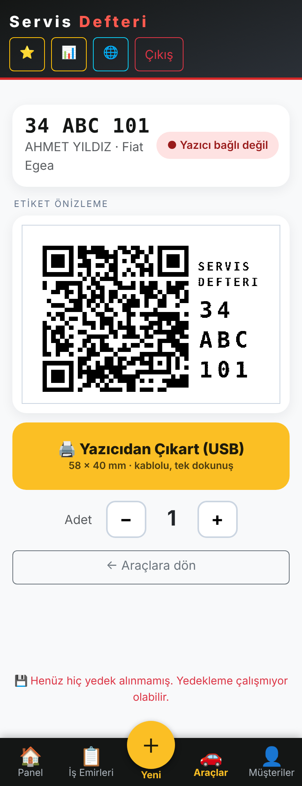 <br> Etiket ekranı | 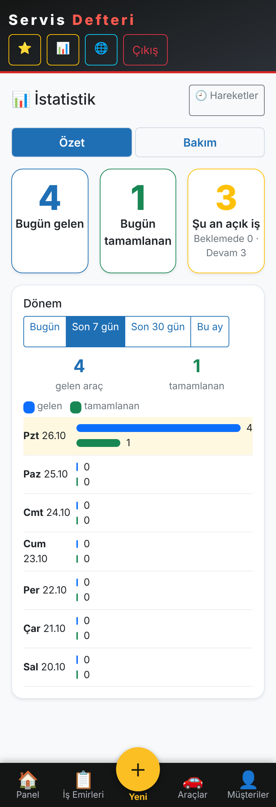 <br> İstatistik |
| 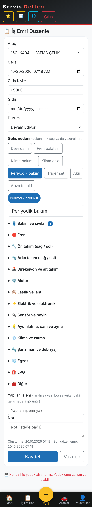 <br> İş emri düzenle | 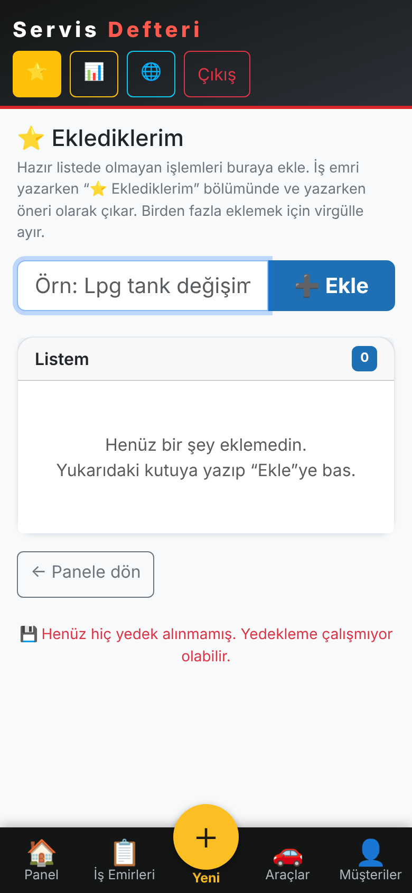 <br> Eklediklerim | 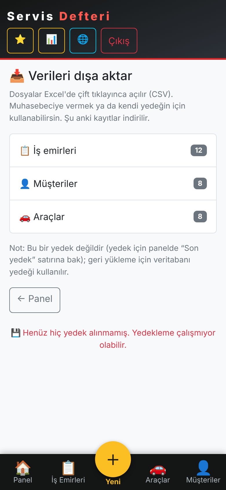 <br> Dışa aktarma |
| 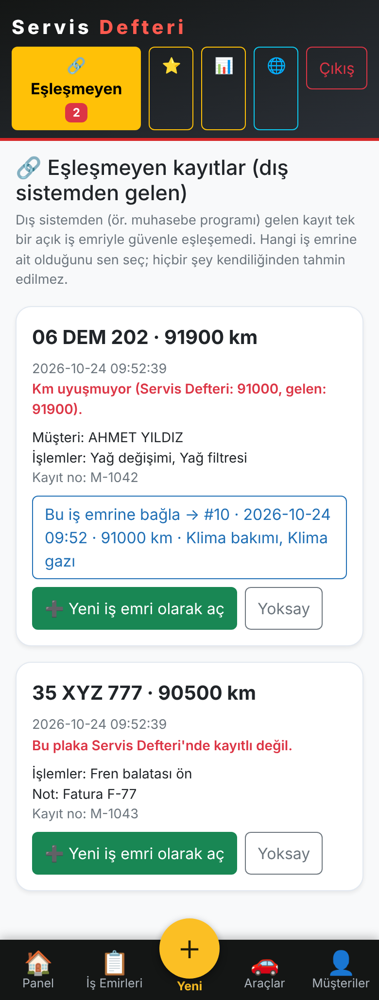 <br> Entegrasyon: eşleşmeyen kayıtlar | | |

Masaüstü görünümü: [14-masaustu-is-emirleri.png](docs/screenshots/windows/14-masaustu-is-emirleri.png) · Linux (yeşil tema) görüntüleri: [`docs/screenshots/linux/`](docs/screenshots/linux)

| Linux (yeşil) | | |
|---|---|---|
| 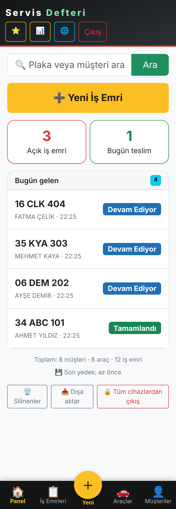 | 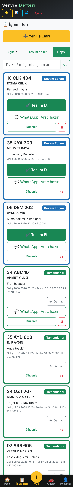 | 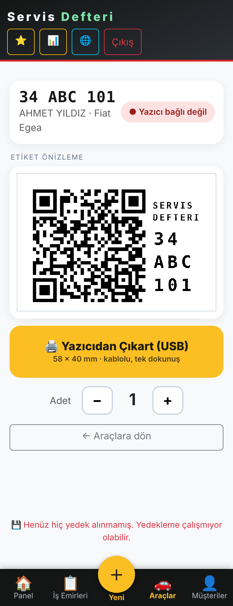 |

> Ekran görüntülerindeki tüm isimler, plakalar ve telefonlar uydurmadır.

## Teknoloji

Python 3 · Flask 3 · Waitress · SQLite (WAL) · Jinja2 · Bootstrap 5.3 (yerel) · qrcode/Pillow · pyusb (Linux) / pywin32 (Windows); çok dükkânlı sürümde USB yok (Web Bluetooth).
Tek dosyalık uygulama (`app.py`), veritabanı `data/` altında.

## Durum

- **Windows ve Linux sürümleri** gerçek servislerde günlük kullanımda çalışıyor (Linux: Raspberry Pi + Xprinter XP-470B ile donanımda test edildi).
- **Windows** yazdırma yolu ve kurulum betikleri otomatik testlerle (sahte yazıcı) doğrulandı; ilk gerçek yazdırma `windows\ETIKET-DENEME.bat` ile doğrulanmalıdır.
- **Çok dükkânlı sürüm** otomatik testlerle (dükkânlar arası izolasyon, yönetici, yedek/geri yükleme) doğrulandı; Bluetooth yazdırma sahte yazıcıyla denendi, **gerçek yazıcıyla ilk deneme yapılmalıdır** (yazıcı BLE desteklemelidir).
- Otomatik testler (`tests/`) her push'ta GitHub Actions ile üç klasör için de koşar.

## Güvenlik özeti

Şifre PBKDF2-SHA256 (600.000 tur) · CSRF koruması · yanlış giriş sınırı · "tüm cihazlardan çıkış" · cihaz adı + hareket kaydı · güvenlik başlıkları ·
panel arama motorlarına kapalı · QR sayfasında müşteri adı maskeli. İlk açılışta rastgele yönetici şifresi üretilir (sabit şifre yoktur).
**`.env` ve `data/` klasörünü asla GitHub'a yükleme** (`.gitignore` dışlar). Ayrıntı: [GUVENLIK.md](linux/docs/GUVENLIK.md).

## Testler

```bash
cd linux      # ya da: cd windows / cd bulut
pip install -r requirements.txt
for t in tests/*.py; do python "$t"; done
```

## Lisans

**Yalnızca inceleme (view-only).** Kod bu depoda okunabilir; kullanım, kopyalama, değiştirme ve dağıtım için yazılı izin gerekir. Ayrıntı: [LICENSE](LICENSE).

## İletişim
Kullanım izni, soru veya iş birliği için: **ahmet.taner.2002@hotmail.com**

---

## English summary

**Servis Defteri** ("Service Ledger") is a lightweight, self-hosted job-card and service-history app for **small independent auto repair shops**.
A mechanic opens a work order from a phone in ~10 seconds (only **plate and entry mileage are required**), tracks status, sends WhatsApp
notifications and hands the customer a **QR service card** (plus a printable 58×40 mm thermal label) showing the vehicle's service history with masked personal data.

Three self-contained packages: [`windows/`](windows) (one-click installer, scheduled task, USB/Google Drive backup), [`linux/`](linux) (systemd, Raspberry Pi) and [`bulut/`](bulut) (multi-shop: one internet-facing Linux server, each shop signs in with its own username/password and gets a fully separate database; admin creates accounts; labels are printed from the shop's phone over Bluetooth LE).
Stack: Flask 3, Waitress, SQLite, Jinja2, Bootstrap 5. UI language: Turkish.

**License: view-only.** The source is public for inspection; it is not licensed for use, copying, modification or distribution. See [LICENSE](LICENSE).

**Contact:** ahmet.taner.2002@hotmail.com (permission requests, questions, collaboration).
