# 🔧 Servis Defteri

**Küçük oto servisler için sekreter gerektirmeyen, tek ekranlı iş emri ve servis geçmişi uygulaması.**
Telefondan kullanılır, Raspberry Pi gibi küçük bir cihazda çalışır, bulut aboneliği gerektirmez.

[English summary below](#english-summary)

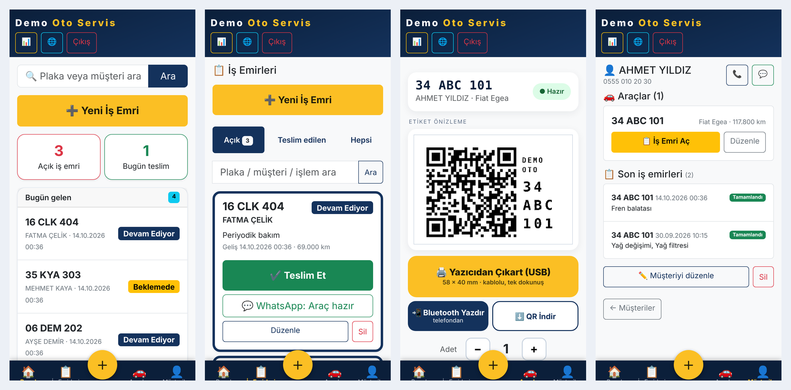

---

## Ne işe yarar? (Amaç)

Küçük bir servisin en büyük derdi **kayıt tutmak**: "Bu araç en son ne zaman geldi, ne yapıldı,
yağ bakımı ne zaman?" Defter, WhatsApp ve hafıza ile bu iş dağılır. Servis Defteri bunu **araç geldiği anda 10 saniyede**
kayda alıp, müşteriye de **kendi aracının servis geçmişini gösteren bir QR kartı** verecek şekilde çözer.

Tasarım ilkesi: **usta elleri yağlıyken telefonla kullanabilmeli.** Az alan, büyük düğme, ezber gerektirmeyen akış.

## Kimlere hitap eder?

| Kullanıcı | Nasıl işine yarar |
|---|---|
| **Bağımsız oto tamircisi / usta** | Plaka yaz → iş emri aç → bitince tek dokunuşla teslim et. Bakım hatırlatma otomatik. |
| **Lastikçi, yağ değişim, oto elektrik, kaporta, egzoz vb. küçük servisler** | İşlem listesi kendi işine göre öğrenir ve genişler. |
| **1–5 kişilik atölyeler** | Sekreter/ofis yazılımı olmadan düzenli müşteri ve araç kaydı. |
| **Hobi / kendi kendine barındıran (self-host) meraklıları** | Tek dosya Flask uygulaması, SQLite, kolay yedek, sıfır bağımlı servis. |
| **Müşteri** | QR kodu okutarak aracının servis geçmişini görür (kişisel bilgiler maskelenir). |

Başka tamir dallarına (bisiklet, beyaz eşya, telefon…) uyarlamak için işlem listesini ve metinleri değiştirmek yeterlidir.

## Genel işleyiş

```
Araç gelir ──► Plaka yazılır ──► Müşteri/araç otomatik bulunur (yoksa tek formda eklenir)
      │
      ▼
  İşlemler seçilir (sık yapılanlar tek dokunuş) ──► İş emri açılır  [Beklemede]
      │
      ▼
  Devam Ediyor ──► Tamamlandı ──► "Araç hazır" WhatsApp mesajı (tek dokunuş)
      │
      ▼
  Teslim: tek dokunuş, "Araç teslim edildi mi?" ──► Araç etiketi (QR) yazdırılır / araca yapıştırılır
      │
      ▼
  Sonraki gelişte QR okutulur ──► "İş Emri Aç" ile geçmiş görünür, yeni kayıt tek dokunuşla açılır
```

1. **Vitrin sayfası (`/`)** – Herkese açık tanıtım sayfası: açık/kapalı rozeti, ara/WhatsApp/yol tarifi. Tamamen `.env` ile ayarlanır.
2. **Usta paneli** – Şifre korumalı. Özet, açık işler, müşteriler, araçlar, yaklaşan bakımlar.
3. **QR servis kartı (`/arac/<token>`)** – Her araca özel, tahmin edilemez adres. Müşteri geçmişi görür; usta olarak girişliysen aynı sayfadan
   **Ara / Haber Et / İş Emri Aç** çubuğu çıkar.
4. **Etiket yazdırma** – 58×40 mm yatay QR etiketi, USB ile TSPL termal yazıcıya tek dokunuşla. **Xprinter XP-470B üzerinde gerçek donanımla test edildi.**

## Özellikler

- Tek ekranda **hızlı iş emri** (plaka formatı doğrulama, müşteri otomatik bulma, aynı araç için açık iş uyarısı)
- **İşlem seçici**: sık yapılanlar öğrenilir (son 180 gün), kategoriler, öneriler, kendi işlemini ekleme
- Durum akışı: Beklemede → Devam Ediyor → Tamamlandı → **Teslim** (tek yeşil onay: "Araç teslim edildi mi?")
- **Para takibi bilinçli olarak yok**: tutar, ödeme, veresiye ve tahsilat alanı bulunmaz; uygulama yalnızca servis kaydını tutar
- **WhatsApp şablonları**: araç hazır, bakım hatırlatma
- **Müşteri sayfası**: müşterinin araçları ve son iş emirleri tek ekranda; müşteri/araç düzenleme, **arama**, **istatistik** (özet, bakım hatırlatma)
- **Excel/CSV dışa aktarma** (`/disa-aktar`): müşteriler, araçlar, iş emirleri; Excel'de çift tıklayıp açılır (UTF-8, `;` ayraç, formül enjeksiyonuna karşı korumalı)
- **Silinenler (çöp kutusu)**: 30 gün geri alınabilir
- **QR servis kartı** + **58×40 mm yatay etiket** (büyük QR, işletme adı, plaka)
- **Yedek**: `sqlite3 .backup`, 30 gün saklama, isteğe bağlı USB ve rclone (Google Drive vb.); panelde tek bir yedek uyarısı
- **Çevrimdışı çalışır**: Bootstrap yerel dosyadır (CDN yok), internet kesilse de arayüz açılır
- Telefonda öncelikli (mobile-first) arayüz, masaüstünde de çalışır
- Türkçe arayüz

## Ekran görüntüleri

| | | |
|---|---|---|
| 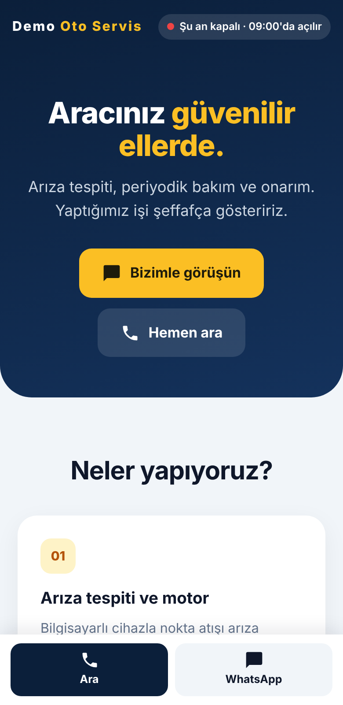 <br> Vitrin | 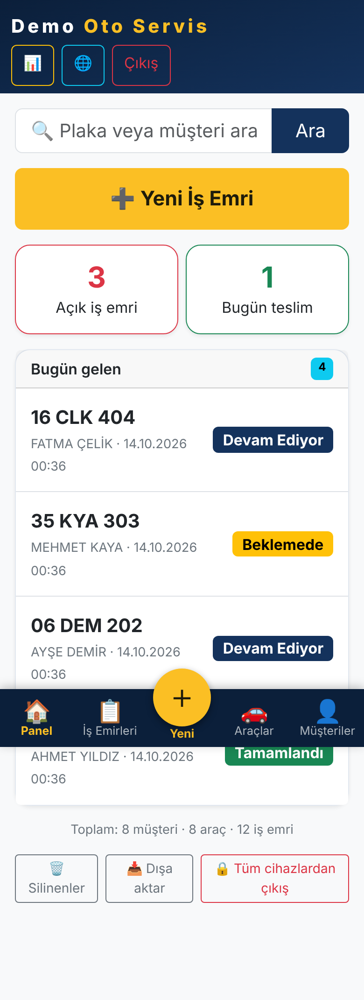 <br> Panel | 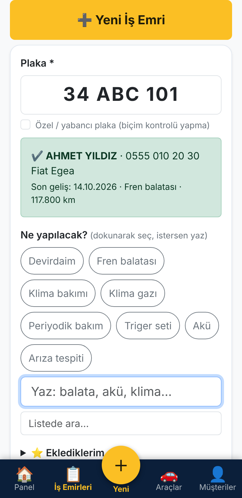 <br> Hızlı iş emri |
| 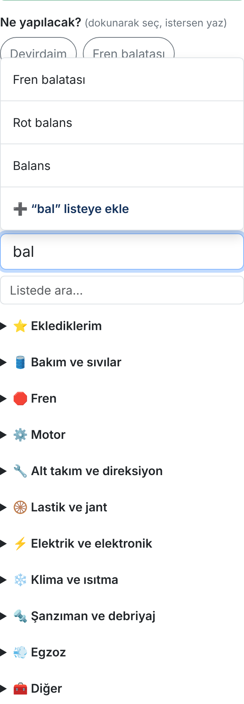 <br> İşlem seçici | 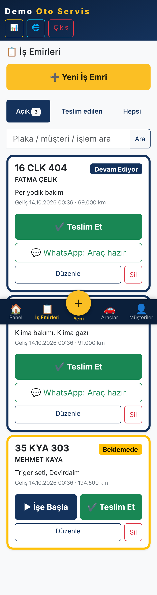 <br> İş emirleri | 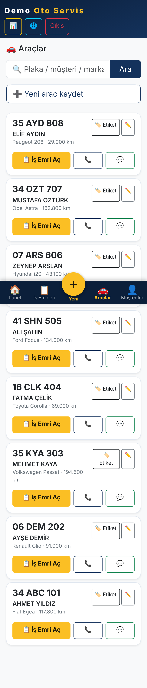 <br> Araçlar |
| 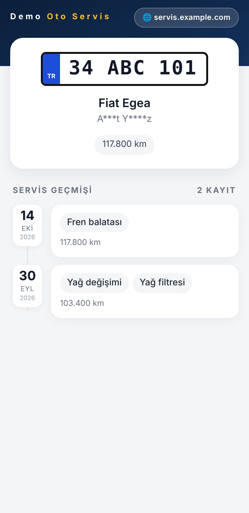 <br> QR kartı (müşteri) | 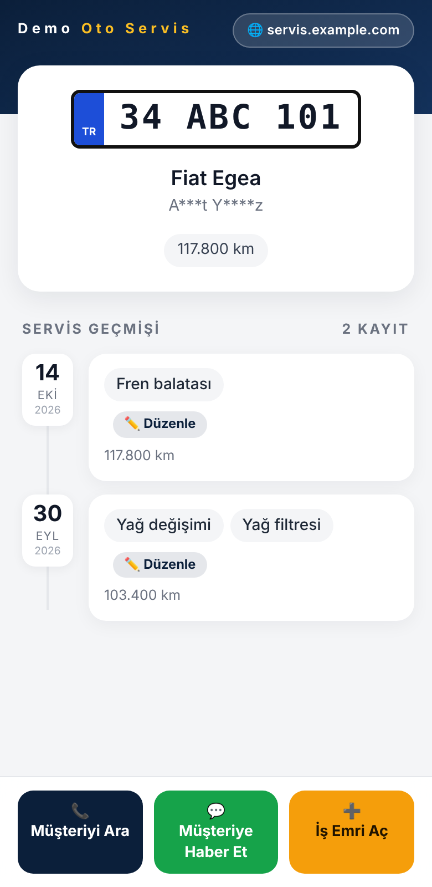 <br> QR kartı (usta girişli) | 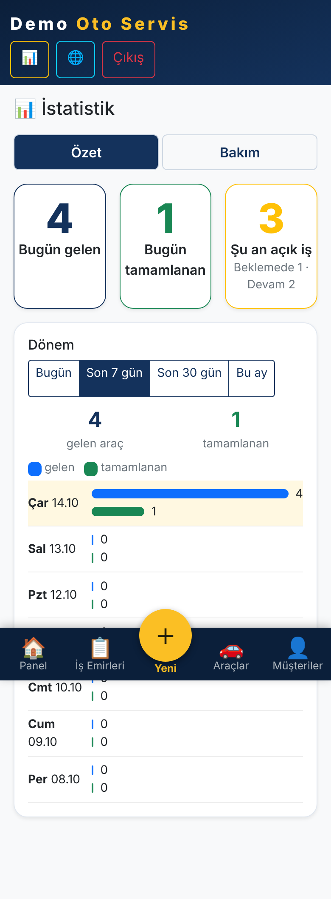 <br> İstatistik |
| 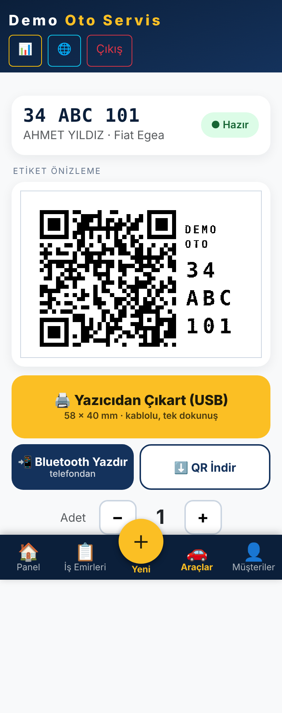 <br> Etiket ekranı | 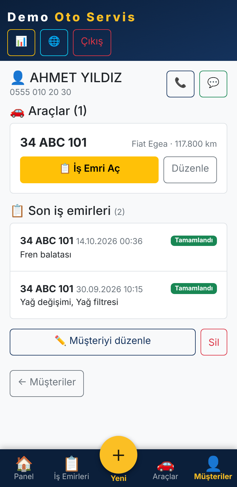 <br> Müşteri sayfası | 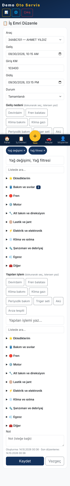 <br> İş emri düzenle |
| 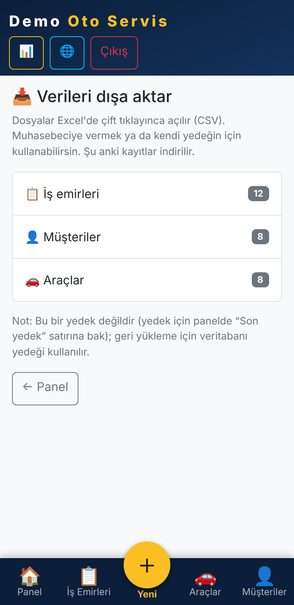 <br> Excel/CSV dışa aktarma | 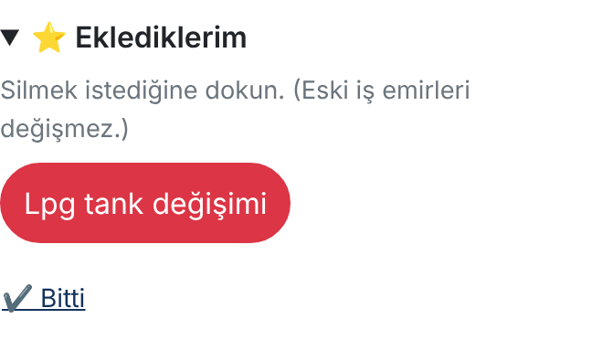 <br> Kendi işlemlerini düzenle | |

Etiket önizlemeleri (58×40 mm): [11-etiketler.png](docs/screenshots/11-etiketler.png)
· Masaüstü görünümü: [docs/screenshots/14-masaustu-is-emirleri.png](docs/screenshots/14-masaustu-is-emirleri.png)
· Giriş: [02-giris.png](docs/screenshots/02-giris.png)

> Ekran görüntülerindeki tüm isimler, plakalar ve telefonlar uydurmadır (`scripts/demo_veri.py`).

## Teknoloji

Python 3 · Flask 3 · Waitress · SQLite (WAL) · Jinja2 · Bootstrap 5.3 (yerel, `static/vendor/`) · qrcode/Pillow · isteğe bağlı pyusb.
Tek dosyalık uygulama (`app.py`), veritabanı `data/` altında. Raspberry Pi 4 üzerinde, Cloudflare Tunnel arkasında test edilmiştir.

## Donanım ve test durumu

- **Sunucu:** Raspberry Pi 4B, Raspberry Pi OS, Waitress + systemd, Cloudflare Tunnel arkasında.
- **Yazıcı:** **Xprinter XP-470B (203 dpi, TSPL, USB) ile gerçek yazdırma test edildi ve çalışıyor.** 58×40 mm etiket, yatay.
  Uygulama yazıcıyı pyusb ile doğrudan bulur (Linux'un `usblp` sürücüsü gerekirse ayrılır); olmazsa `/dev/usb/lp*` denenir.
  Başka TSPL yazıcılar da çalışabilir; USB kimliğini `.env` içinde `ETIKET_USB_ID=xxxx:yyyy` ile verirsin ([docs/YAZICI.md](docs/YAZICI.md)).
- **Otomatik testler:** her push'ta GitHub Actions ile (Python 3.10 ve 3.12) 300'den fazla kontrol koşar; yazıcı sahte USB aygıtıyla taklit edilir.

## Hızlı başlangıç

```bash
git clone https://github.com/KULLANICI/servis-defteri.git
cd servis-defteri
bash scripts/kurulum.sh        # venv + bağımlılıklar + .env + systemd dosyası üretir
nano .env                      # işletme adı, telefon, adres...
venv/bin/python app.py         # deneme: http://localhost:5000
```

İlk açılışta **rastgele bir yönetici şifresi** üretilir; konsola bir kez yazılır ve `data/ILK_SIFRE.txt` dosyasına kaydedilir
(sabit/varsayılan şifre yoktur). Giriş yaptıktan sonra değiştir:

```bash
venv/bin/python scripts/sifre_degistir.py
```

Deneme için sahte veri: `venv/bin/python scripts/demo_veri.py` (yalnızca veritabanı boşsa çalışır).

Ayrıntılar: [docs/KURULUM.md](docs/KURULUM.md) · [docs/YAZICI.md](docs/YAZICI.md) · [docs/GUVENLIK.md](docs/GUVENLIK.md)

## Ayarlar (`.env`)

Hepsi isteğe bağlıdır; örnek ve açıklamalar için [`.env.example`](.env.example).

| Değişken | Anlamı |
|---|---|
| `ISLETME_ADI`, `ISLETME_TEL`, `ISLETME_ADRES`, `ISLETME_ACIKLAMA` | Vitrin, QR sayfası, WhatsApp mesajları |
| `ACILIS_SAATI`, `KAPANIS_SAATI`, `SAAT_DILIMI` | Vitrindeki "Şu an açık/kapalı" rozeti |
| `HARITA_EMBED_URL`, `HARITA_LINK` | Harita ve yol tarifi (boşsa gizlenir) |
| `PUBLIC_BASE_URL` | QR kodlarının göstereceği herkese açık adres |
| `ETIKET_BASLIK` | Etikette yazan ad (≤18 karakter) |
| `RCLONE_REMOTE` | Bulut yedeği hedefi |
| `FORCE_HTTPS_COOKIE`, `SECRET_KEY`, `APP_PASSWORD_HASH` | Gelişmiş |

Kendi logon için `static/logo.png` dosyasını koy (bkz. `static/LOGO.txt`).

## Güvenlik özeti

Şifre PBKDF2-SHA256 (600.000 tur) ile saklanır · CSRF koruması · yanlış giriş sınırı (dakikada 5/IP) ·
90 gün oturum + "tüm cihazlardan çıkış" · güvenlik başlıkları (CSP, X-Frame-Options, nosniff…) ·
panel sayfaları arama motorlarına kapalı · QR sayfasında müşteri adı maskelenir, telefon yalnızca girişli ustaya görünür.
**`.env` ve `data/` klasörünü asla GitHub'a yükleme** (`.gitignore` bunları dışlar). Ayrıntı: [docs/GUVENLIK.md](docs/GUVENLIK.md).

## Testler

```bash
for t in tests/*.py; do python "$t"; done
```

Testler geçici bir kopyada çalışır, gerçek veriye dokunmaz; yazıcı gerekmez (sahte USB aygıtı ve geçici dosya kullanılır). GitHub Actions ile her push'ta otomatik koşar.

## Proje yapısı

```
app.py                 uygulama (rotalar, veritabanı, güvenlik)
etiket_yazici.py       TSPL etiket üretimi ve USB gönderimi
templates/, static/    arayüz
scripts/               kurulum, yedek, şifre değiştirme, demo veri
deploy/                systemd ve udev örnekleri
tests/                 otomatik testler
docs/                  kurulum / yazıcı / güvenlik + ekran görüntüleri
```

## Sınırlar ve yol haritası

- Tek ustalı/tek şifreli kullanım için tasarlandı (çok kullanıcılı rol sistemi yok).
- Tek dosyalık `app.py`; büyürse modüllere bölünebilir. Veritabanı şeması otomatik oluşturulur, ayrı migrasyon aracı yoktur.
- Para/ödeme takibi yoktur; istersen kendi muhasebe programınla birlikte kullan (CSV dışa aktarma buna yardım eder).
- Etiket tek türdür: 58×40 mm yatay. Başka ölçü için `etiket_yazici.py` içindeki `ETIKET_W_MM`/`ETIKET_H_MM` ve yerleşim değiştirilmelidir.
- Fikirler: parça-stok takibi, çoklu şube, SMS entegrasyonu, isteğe bağlı fiyat/ödeme modülü. Katkılar (PR/Issue) açıktır.

## Lisans

[MIT](LICENSE) — özgürce kullan, değiştir, dağıt.

---

## English summary

**Servis Defteri** ("Service Ledger") is a lightweight, self-hosted job-card and service-history app for **small independent auto repair shops**.
A mechanic opens a work order from a phone in ~10 seconds (plate → customer/vehicle auto-lookup → pick tasks → done),
tracks status, sends WhatsApp notifications, and hands the customer a **QR service card** (and a printable thermal label)
that shows the vehicle's service history publicly with masked personal data.

It deliberately has no money/payment tracking. Prints a 58×40 mm QR label over USB (TSPL) — **verified on real hardware with an Xprinter XP-470B**. Works offline (Bootstrap is bundled), exports CSV.

Stack: Flask 3, Waitress, SQLite (WAL), Jinja2, Bootstrap 5. Runs on a Raspberry Pi. No default password: a random one is generated on first run.
UI language is Turkish; texts live in `templates/` and `app.py` and can be translated. See the screenshots above, `docs/` and `.env.example` to get started. MIT licensed.
